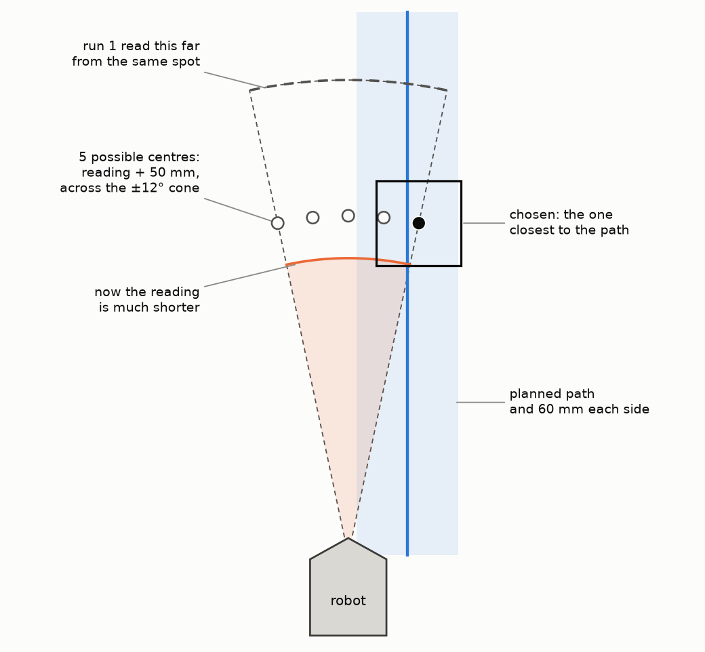

# Algorithms

The technical companion to [HOW_IT_WORKS.md](HOW_IT_WORKS.md). Distances are in mm, angles in radians,
counter-clockwise positive. x runs along the start line, y forward. Why each number was chosen is in
[DECISIONS.md](DECISIONS.md).

## One control step (30 Hz)

```
gyro (averaged), encoder counts, 3 ranges        main.cpp      waitStep
odometry -> pose (x, y, θ)                       odometry.cpp  FusedOdometry::update
health check -> may we move?                     course.cpp    checkSensors, Supervisor
finish-lane correction                           navigator.cpp keepLane
Navigator::step
    detectBlocks, updateTrust
    back off, if a block appeared very close
    replan, if a block was added                 planner.cpp   Planner::plan
    track: pure pursuit -> two wheel commands
wheel speed targets -> 200 Hz speed loop         motor.cpp
```

## 1. Odometry

Each step, the encoder counts give the distance of each wheel, `dl` and `dr`.

```
ω_enc = (dr - dl) / track / dt                      track = 82 mm
ω     = 0.98 · ω_gyro + 0.02 · ω_enc                if |ω_enc - ω_gyro| ≤ 1 rad/s
ω     = ω_gyro                                      otherwise (a wheel is slipping)

ds = (dl + dr) / 2
x += ds · cos(θ + ω·dt/2)
y += ds · sin(θ + ω·dt/2)
θ += ω · dt
```

Using the heading at the middle of the step follows a curve better than the heading at its start.

The gyro's zero offset is measured at power-on and again in every start countdown. It is also tracked slowly whenever
the robot stands still with the motors off.

## 2. Route planning (`planner.cpp`)

### Grid

The arena (x 0 to 1800, y -200 to 1200) is divided into 40 mm cells, 46 × 36. Each cell stores its **clearance** `c`:
the distance to the nearest block surface, in one byte (2.5 mm units). Cells outside the track, or within 70 mm of its
edge, are 0.

The mapped blocks are computed once. A detected block is added on top as a disc of radius 50 around its estimated
centre.

### A* search

- Neighbours: 8 directions. A cell can be used only if `c ≥ 90`.
- Cost of a move: `length × (m(a) + m(b)) / 2`, with length 10 (straight) or 14 (diagonal) and
  `m(c) = 1 + 6 · t²`, where `t = clamp((140 - c) / 140, 0, 1)`.
  So a cell touching a block costs up to 7 times more than an open one, and the path stays central.
- Heuristic: octile distance to the goal area.
- Goal: any cell past the finish line (y ≤ -120) with x from 1260 to 1750.
- If there is no route, the required clearance is lowered to 80, then 45.
- If there is still none and a block was detected, the detections are thrown away and it plans on the map alone.

### Turning the cells into a drivable path

1. **Shortcutting** (string pulling): skip waypoints wherever a straight line keeps 110 mm clearance.
2. **Corner smoothing** (Chaikin, twice): replace each corner with two points at ¼ and ¾ of its sides. Kept only if
   the result stays 85 mm clear.
3. **Extend** 300 mm past the end, so the robot drives through the finish line instead of aiming at it.
4. **Resample** to one point every 20 mm.
5. **Straighten the finish lane:** below y = 440, points between x = 1500 and 1700 are moved to x = 1585, 15 mm left of
   the middle of the lane (eased in from y = 560). Skipped if a detected block is in or beside the lane.

### Speed factor for each point

```
v_clear = clamp(0.4 + 0.6 · (clearance - 95) / 35,     0.4,  1)     tight gaps
v_edge  = clamp(0.5 + 0.5 · (edge distance - 70) / 220, 0.5,  1)     near the track edge
v_turn  = clamp(1 / (1 + 1.75 · |heading change|),      0.35, 1)     heading change over ±5 points

factor  = min(v_clear, v_edge) · v_turn
```

## 3. Path following (`Navigator::track`)

Pure pursuit:

1. Find the path point nearest the robot (searching forward only). More than 250 mm off the path: replan.
2. Pick a target point a lookahead distance further along: `L = 85 + 0.18 · speed`.
3. `α` = angle from the robot's heading to the target, `d` = distance to it.
4. If `|α| > 1.2` rad (the target is far to the side), turn on the spot.
5. Otherwise drive the arc through the target:

```
κ       = 2 · sin(α) / d                    curvature
v_left  = v · (1 - κ · track / 2)
v_right = v · (1 + κ · track / 2)
```

If either wheel would exceed full command, both are scaled down together, which keeps the curve's shape.

### The speed `v`

```
v = 680 · sqrt(factor) · max(0.35, cos α)
```

Then, in order:

| Condition | Effect |
|---|---|
| x ≤ 1050 | `factor` is at least 0.5 |
| Run 2, x > 950, block not yet passed | × 0.65 |
| A block was found less than 0.8 s ago | × 0.5 |
| Always | at least 150 mm/s |
| y < 250 (final stretch) | at least 306 mm/s |

## 4. Detecting the extra block (`Navigator::detectBlocks`)

The robot has no camera. All it knows is three distances. The question it asks is: *"is something closer than it
should be, from where I am?"*

```
for each sensor:
    expected distance  ->  is the reading clearly shorter?  ->  for 5 steps in a row?
    ->  where would the block be?  ->  is that plausible, and in my way?
    ->  add it, replan
```



### Step 1: what should this sensor read?

**From run 1 (the usual case).** Every step of run 1 was saved with its pose and three ranges. To find what is
expected *here*, take all saved records within 45 mm in x and y and 220 mrad (about 13°) in heading. If there are at
least two, the expected value for each sensor is the **shortest** reading among them. The shortest, because it is the
most cautious: from nearly the same spot a sensor may or may not catch the corner of a block.

One exception: the front sensor sometimes reads a false 30 to 80 mm on open floor. So its **second** shortest value is used (one stray cannot set it), or the
**median** if that is still below 80 mm.

**From the map (where run 1 never was).** After dodging, the robot is somewhere run 1 did not drive. Then it casts rays
from the sensor's position at the mapped blocks and the course's boundary lines, and takes the nearest hit.

> **Known mismatch:** the code treats the course boundaries as walls the sensors can see. The course has no physical
> walls. This only matters in this map fallback, not when comparing with run 1.

Comparing with run 1 works much better than the map: errors in block positions, sensor quirks and things missing from
the map were all there in run 1 too, so they cancel out.

### Step 2: is the reading short?

| Expected from | Short when |
|---|---|
| Run 1 | `z < expected - 100`, and `40 ≤ z < 800` |
| Map | `z < expected - (40 + 0.08 · expected)`, and `z < 800` |

It must stay short for **5 consecutive steps** (about 0.17 s). One normal reading resets the count. While driving
straight down a lane, for the front sensor the point it hits must also stay within 40 mm of where the count started: a burst of false readings wanders, a
real block stays put while the robot closes in.

### Step 3: where is the block?

A VL53L0X sees a cone about ±12° wide, not a thin line, so a reading gives a distance but not an exact direction.

Five directions across the cone are tried. For each, the block's centre would be:

```
centre = sensor position + (z + 50) · (cos a, sin a)          50 = half a block
```

The one **closest to the planned path** is kept. This assumes the worst case: if the block could be in the way, treat
it as in the way.

### Step 4: filters

All must pass. A new block is also never placed from a side sensor reading beyond 350 mm: at 45 degrees and that
range the position is too uncertain.

| Check | Rejects |
|---|---|
| Surface hit point has x ≥ 1150 | anything outside the right-hand section |
| Hit point within 150 mm of the path in the next 700 mm | things off to the side |
| *(map mode only)* hit point 150 mm from every wall and mapped block | known things seen slightly out of place |
| Centre has 1160 ≤ x ≤ 1800 and y ≥ 0 | impossible places |
| (x is then raised to at least 1250) | a block cannot stand further left |
| Centre within 60 mm of the path | blocks that would not actually be hit |

### Step 5: record it

If a side sensor reads under 80 mm at that moment, the block is placed from **that** reading instead (when it is within
200 mm of the guess and not a mapped block): something right beside the robot is located far better by it.

- A detection within 180 mm of a known block is **the same block**. For the first few, the stored position moves 30%
  of the way towards the new estimate.
- Otherwise it is a new block, up to a limit of 1 (0 in run 1, so run 1 never reacts).
- A new block triggers a replan (about 0.15 s, motors holding their last command) and a short slow-down.

### Example

Run 1 read 600 mm ahead at this spot. Now the front sensor reads 350 mm.

1. 350 is below 600 - 100, so it is short.
2. It stays short for 5 steps.
3. The block's centre is estimated 400 mm from the sensor, in the direction nearest the path.
4. It is in the right-hand section and on the path, so it is accepted.
5. The planner adds a disc there and finds a way round.

### After detection

- **Back off:** if the new block is within 200 mm, reverse for 10 steps (fewer if a mapped block is behind), then turn on the spot until facing the new
  route before driving.
- **Trust:** once at least 3 short readings agree on the block and the robot is 150 mm past it, detection switches off
  and the caution speed limit is lifted.
- **Finish lane:** after a block was found, in the narrow lane at the end (x ≥ 1450, y ≤ 600, driving down), a side
  reading under 90 mm shifts the position estimate 4 mm per step towards that side, so the steering moves away.
  At most 60 mm in total.

### When detection can fail

- A block just **beside** the path (8 to 12 cm off) is not "in the way" by these rules, yet can still be clipped.
- A block **outside the right-hand section** is ignored.
- If the position estimate has **drifted**, the readings are compared with the wrong spot.
- Only **one** extra block is handled.
- Run 1 must have driven **without** the block. If it was there, it looks normal in run 2.

## 5. Wheel speed control (200 Hz)

```
speed = encoder counts over the last 4 ticks, then low-pass filtered
duty  = target / gain + offset          feed-forward: the measured motor behaviour
      + 0.0006 · error + 0.003 · ∫error PI correction, limited to ±0.3
```

`gain` is about 2700 mm/s per unit of duty and `offset` about 0.067 (the power needed before a wheel starts to turn),
measured separately for each wheel. The integral is also limited, so it cannot build up while the output is saturated.

## 6. Safety supervisor (`reliability.h`)

```
Ready -> Running -> Done
            |  ^
   problem  v  |  healthy and still for 0.5 s
          Recovering                          serious problem -> Fault (needs reset)
```

Separately, each motor command expires after 150 ms (600 ms around a replan), so a frozen program stops the robot.

## Not in use: position correction (`Navigator::localize`)

It compares readings near mapped blocks with what the map predicts, and tries 26 nearby poses (±20 mm, ±0.035 rad)
for a better fit. It is switched off: some blocks stand a few cm from where the map says, and it once moved the
position by 5 cm in one go.
