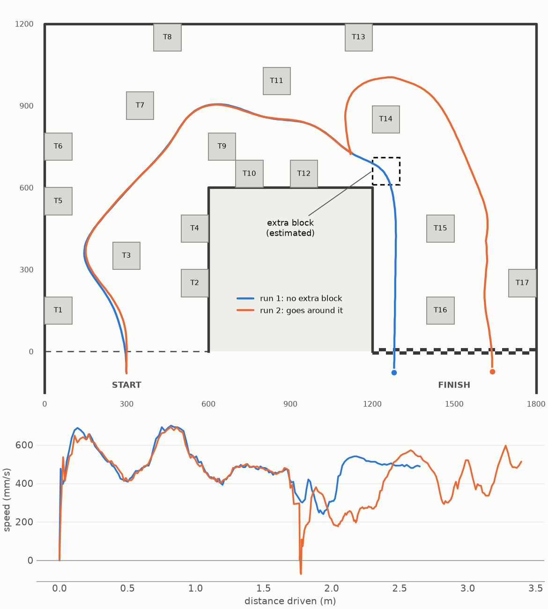
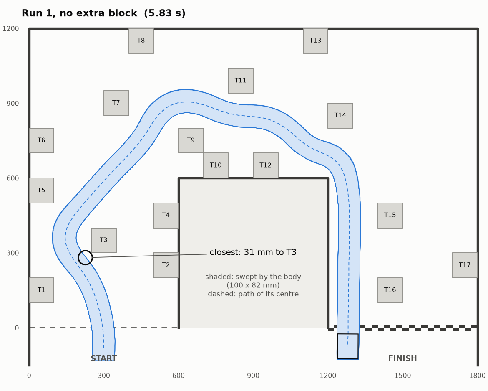
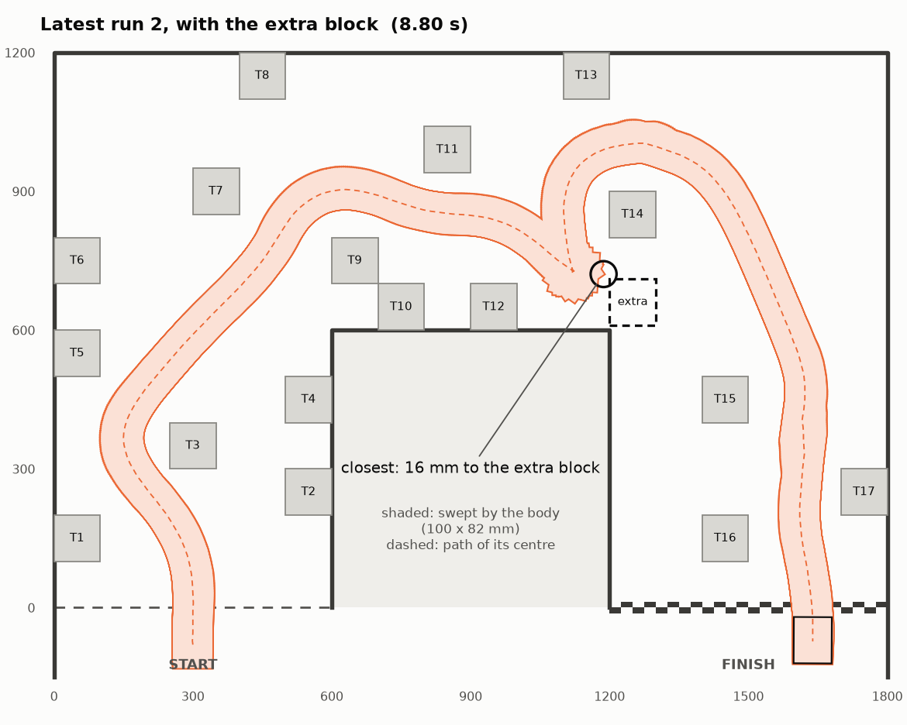

# How the robot works

A guided tour of the project: what the robot does, how it does it, and where to find each part in the code.
For the formulas and the block detection in detail, see [ALGORITHMS.md](ALGORITHMS.md).
For *why* a setting has its value, see [DECISIONS.md](DECISIONS.md).

## The task

The robot drives by itself from the start line to the finish line, through a course with 17 blocks whose positions are
known in advance. One extra block can be placed in its way, and the robot has to notice it and drive around it.

## The hardware

| Part | Job |
|---|---|
| Blue Pill (STM32F103C8) | The brain. Small: 64 KB of flash, 20 KB of RAM, no hardware for decimal maths. |
| 2 DC motors with encoders | Drive the wheels and count how far each one turned. |
| MPU6050 gyro | Measures how fast the robot is turning. |
| 3 VL53L0X distance sensors | Measure the distance to things: one looks ahead, two look 45° left and right. |
| KEY button and LED | The only controls. |

## Using it

**Run 1, without the extra block.** The robot learns what the course "looks like" to its sensors.

**Run 2, with the extra block.** It compares what it sees with run 1. Anything noticeably closer than before is a
new block.



*A real pair of runs, drawn from the robot's own position estimate.*

### How close it gets

The shaded area is everything the robot's body passed over, taken as a rectangle 100 mm long and 82 mm wide (the
wheel separation), centred on the logged position. Its edge is the collision line.





These come from the robot's own position estimate, so they show where it *thought* it was, not a measurement. A few cm
of drift is enough to turn a near miss into a hit. The extra block's position is also an estimate.

Step by step:

1. Switch on and don't touch it for about 4 seconds while the gyro calibrates.
2. Press KEY and let go. There is a 3 second countdown. When the LED turns solid, keep your hands off: the gyro is
   being calibrated again.
3. The robot drives and stops after the finish line.
4. Carry it back to the start and press KEY for the next run.

Run 1 is remembered after switching off. To forget it and learn again, hold KEY for 2 seconds during a countdown.

### What the LED means

| LED | Meaning |
|---|---|
| Slow, even blink | Ready for run 1 |
| Double blink | Ready for run 2 (run 1 is stored) |
| Fast blink | Countdown |
| Solid | Calibrating, driving, or finished |
| N short flashes, then a pause | Fault number N, see below |

Faults: 1 sensor, 2 timing, 3 motor command expired, 4 no route, 5 position, 6 configuration, 7 time limit,
8 the chip reset during a run.

## How it drives

About 30 times a second, the robot goes round this loop:

```
 read the sensors  ->  where am I?  ->  is there a new block?  ->  where do I steer?  ->  how fast is each wheel?
```

**1. Where am I?** The wheel encoders say how far it moved and the gyro says how much it turned. Adding these up
from the start line gives a position and heading. This is called *odometry*. Small errors build up over a run, which is
the main limit on how precise the robot can be.

**2. Is there a new block?** Only in run 2. A block counts when all of these are true:

- a sensor reads at least 10 cm closer than it did at the same spot in run 1,
- it keeps doing so for about 0.17 seconds,
- the block would be in the right-hand section of the course,
- and it would actually stand on the robot's path.

Where run 1 never drove, the sensor reading is compared with the map instead. The strict rules are there because a false block is as bad as a missed one: the robot would swerve for nothing.

**3. What route do I take?** The *planner* divides the course into 4 cm squares and searches for the best path from
the robot to the finish (an algorithm called A*). Squares close to blocks cost more, so the path keeps its distance.
The corners are then smoothed, and each point gets a speed: slower in tight gaps and sharp bends.

The route is planned at the start, and again if a new block turns up. Planning takes the small chip about 0.15 seconds.

**4. Where do I steer?** The robot picks a point on the route a little way ahead and drives a curve towards it
(*pure pursuit*). The faster it goes, the further ahead it looks, so it doesn't weave.

**5. How fast is each wheel?** Step 4 asks for a speed from each wheel. A second, faster loop (200 times a second)
makes the motors deliver it: it estimates the power needed, then corrects using what the encoders measure.

### Extra tricks around the block

- It slows down in the right-hand section until it has passed the block.
- If the block only appears when very close, it backs off a little before turning.
- In the narrow lane before the finish, the side sensors nudge its position estimate so it steers away from the blocks on either side (T16 and T17).

### Safety

A *supervisor* only lets the motors run while the sensors are healthy and up to date. If something goes wrong, the
motors stop, and the robot carries on once everything has been fine again for a moment. A few serious faults need a
reset. Separately, the motors stop by themselves if the main program stops sending commands.

## How the code is organised

```
include/    settings and declarations
src/        code that runs only on this robot
lib/        reusable parts: the thinking (testable on a PC) and the sensor drivers
test/       automatic tests that run on the PC
tools/      PC scripts for reading and studying runs
data/       logs from real runs
docs/       these notes, the competition rules, the report
```

The important idea: **the "thinking" code knows nothing about the hardware.** `lib/base` and `lib/course_nav` are
given sensor values and return motor commands, so they can be tested on a computer without the robot.

### Settings: start here to change behaviour

| File | What's in it |
|---|---|
| `include/config.h` | The robot itself: which pin is wired to what, wheel size, sensor positions, motor tuning, timing. |
| `include/course_params.h` | The course and driving style: start and finish, speed, caution, block detection rules. |
| `include/map_data.h` | Positions of the 17 known blocks. |

### The robot program (`src/`)

| File | What it does |
|---|---|
| `main.cpp` | Starts everything up, calibrates the gyro, and collects sensor readings on a steady beat. |
| `course.cpp` | **The heart of a run:** button, countdown, driving, finishing, faults and LED. Read this first. |
| `run_record.cpp` | Saves each run in flash memory, including run 1 as the reference. |
| `motor.cpp` | Motors, encoders and the 200 times a second wheel speed loop. |
| `tof_array.cpp` | Runs the three distance sensors. |
| `board.cpp` | Low-level chip setup: clocks, pins, timers. |
| `interrupts.cpp`, `syscalls.cpp` | Plumbing the chip needs. |

`include/` also has a header for each of these (`robot.h`, `motor.h`, `board.h`, ...).

### The reusable parts (`lib/`)

| Folder | What it does |
|---|---|
| `course_nav/` | The navigation. `planner` finds the route, `navigator` follows it and detects new blocks, `geometry` does distances to blocks and walls. |
| `base/` | Building blocks: odometry, PID and wheel speed control, the safety supervisor, small maths helpers. |
| `i2c_bus/` | Talks over the two-wire bus the sensors share. |
| `mpu6050/` | Gyro driver. |
| `vl53l0x_impl/` | Connects the distance sensor library to this board. |
| `vl53l0x_api/` | The sensor maker's (ST) library. Not our code. |

### Test programs (`src/test_*.cpp`)

Small separate programs, each flashed on its own to check or measure one thing. After using one, **flash
`course_nav` again** or the robot won't run the course.

| Build name | Checks |
|---|---|
| `test_motor` | Motors, encoders and buttons |
| `test_imu` | Gyro |
| `test_tof`, `test_tof_single` | All distance sensors, or just one |
| `test_i2c_scan` | Which devices answer on the sensor bus |
| `test_tof_cal` | Calibrates the distance sensors |
| `test_step`, `test_step_floor` | Measures how the motors respond |
| `test_spin`, `test_gyro_scale` | Checks the gyro's turning angle |
| `test_planner` | How long planning takes on the chip |

### PC side

| File | What it does |
|---|---|
| `tools/analyze.py` | Reads both runs from the robot, saves them in `data/`, compares them and draws them on the map. |
| `tools/read_run.py` | Just reads and prints the runs. |
| `tools/replay_run.cpp` | Replays a saved run through block detection, to try settings without the robot. |
| `tools/read_step.py` | Shows the motor test results. |
| `tools/plot_run_map.py` | Draws the course map (used by `analyze.py`) and the figures in these notes. |
| `tools/plot_report_figs.py` | Draws the figures in the report. |
| `test/` | Automatic tests: maths, sensor layout, safety supervisor, navigation. |

## Common commands

```sh
pio run -e course_nav -t upload     # build and put the program on the robot (ST-Link)
pio test -e native                  # run the tests on the PC
pio test -e native_lowmem           # same tests, with the planner settings the robot uses
python3 tools/analyze.py            # read and study the last runs (ST-Link connected)
```

To flash a test program, use its build name: `pio run -e test_imu -t upload`.

## Things worth knowing

- **Flash memory is nearly full.** About 600 bytes are free. The last 12 KB hold the run logs, and
  `flash_guard.ld` stops the build if the program grows into them.
- **Distances are in millimetres.** x goes right along the start line, y goes forward. Angles are in radians,
  counter-clockwise.
- **Only one extra block is handled.** A second one would be ignored.
- **Position drifts.** There is code to correct it using the known blocks (`Navigator::localize`), but it is switched
  off because it can jump when a block is not exactly where the map says.
- **Run 1 must be a clean finish** to be stored. Otherwise the robot stays in run 1 mode.
